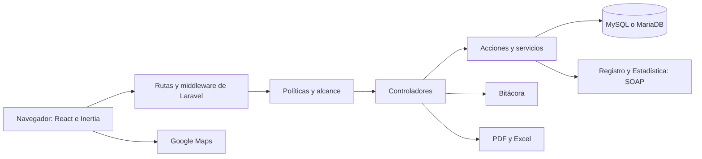
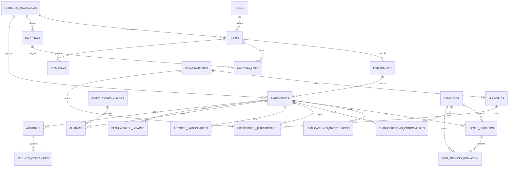

# Base para el manual técnico de SIRSE USAC

Corte: 31 de octubre de 2026, con las correcciones posteriores al commit `80b34012`. No incluye valores secretos.

## 1. Tecnologías

| Capa | Tecnología |
|---|---|
| Backend | PHP (`^8.3`; 8.5 local y 8.4 en Hostinger), Laravel 13 |
| Frontend | React 19, TypeScript, Inertia.js 3 |
| Estilos | Tailwind CSS 4, componentes Radix UI |
| Compilación | vite-plus (`vp`), compilador de React |
| Rutas tipadas | Laravel Wayfinder |
| Autenticación | Laravel Fortify |
| Base de datos | MySQL o MariaDB en servidor; SQLite para pruebas |
| PDF y Excel | barryvdh/laravel-dompdf y OpenSpout 5 |
| Mapas | Google Maps JavaScript API, GeoJSON propio y SVG alterno |
| Calidad | Pest, Larastan, Pint |

**Extensiones PHP necesarias:** `soap`, `zip`, `pdo_mysql`, `mbstring`, `dom`, `xml`, `gd`.

`CLAUDE.md` menciona Jetstream, pero el código usa Fortify con Inertia y React.

## 2. Arquitectura



Es una aplicación monolítica sin API pública propia. Inertia entrega las páginas React desde los controladores.

## 3. Estructura del código

| Ruta | Contenido |
|---|---|
| `routes/web.php` | Portada, consultas, bandeja, panel y administración |
| `routes/estudiante.php` | Verificación y asistente del estudiante |
| `routes/settings.php` | Perfil, seguridad y apariencia |
| `app/Http/Controllers/Admin` | Usuarios, catálogos, territorio, carreras, unidades y bitácora |
| `app/Http/Controllers/Estudiante` | Acceso, ejes, cierre, foto, orden y solicitud |
| `app/Http/Controllers/Panel` | Bandeja, estudiantes y aprobación |
| `app/Http/Requests` | Validaciones |
| `app/Models` | 20 modelos Eloquent |
| `app/Enums` | Roles, estados, ejes, catálogos, métricas y tipos |
| `app/Actions/Estadisticas` | Cálculo y exportación |
| `app/Actions/Expedientes` | Detalle del EPS |
| `app/Concerns/Auditable.php` | Auditoría automática |
| `app/Concerns/LeeFiltrosEstadisticos.php` | Filtros y alcance de consultas |
| `app/Services/RegistroAcademico` | Cliente SOAP de Registro y Estadística |
| `app/Support` | Articulación, Excel y mapa SVG del PDF |
| `app/Policies/ExpedientePolicy.php` | Permisos sobre expedientes |
| `resources/js/pages` | Páginas React |
| `resources/js/components` | Componentes |
| `resources/views/pdf` | Plantillas PDF |
| `database/seeders/data` | Municipios y bienes y servicios |
| `public/mapas/departamentos-gt.geojson` | Límites departamentales |
| `public/build` | Frontend compilado, incluido en Git |
| `vendor` | Dependencias de producción, incluidas en Git |
| `tests/Feature` | Pruebas funcionales |

**Archivos generados:** `resources/js/actions` y `resources/js/routes` provienen de Wayfinder; no se editan a mano.

## 4. Modelo de datos



`docs/der.mermaid` corresponde al diseño inicial y no refleja todos los cambios. Usa este diagrama y las migraciones.

### Tablas principales

| Tabla | Campos clave | Notas |
|---|---|---|
| `roles` | `clave`, `nombre`, `descripcion` | `digeu`, `unidad_academica`, `estudiante`, `invitado` |
| `users` | `email`, `rol_id`, `unidad_academica_id`, `activo`, campos de doble factor | Cuentas de acceso |
| `unidades_academicas` | `nombre`, `siglas`, `tipo`, contacto, coordenadas, `activa` | Borrado lógico |
| `carreras` | Tres códigos, `nombre`, extensión, nivel | Únicas por sus códigos |
| `carrera_user` | `carrera_id`, `user_id` | Carreras del supervisor |
| `estudiantes` | `usuario_id`, `carnet`, nombres, nacionalidad, `carreras` JSON | Carné único; no guarda CUI |
| `expedientes` | Estudiante, unidad, carrera, `programa`, `eje_actual`, estado, fechas de solicitud y aprobación | Único por estudiante y carrera |
| `catalogos` | `catalogo`, `nombre`, `categoria`, `valor_base`, cuatro vínculos, `activo` | Tabla única para siete catálogos |
| `bienes_servicios` | Expediente, catálogo, `tipo`, `descripcion`, `cantidad`, beneficiarios, `fecha` | Eje 1 |
| `bien_servicio_poblacion` | `bien_servicio_id`, `catalogo_id` | Poblaciones vulnerables |
| `publicaciones_investigacion` | `titulo`, `tipo`, `autores`, medio, `resumen`, `enlace`, fecha | Eje 2 |
| `transferencias_conocimiento` | `tipo_actividad`, `actividad`, `comunidad`, participantes, fecha | Eje 3 |
| `ubicaciones_territoriales` | Departamento, municipio, comunidad, coordenadas, referencia | Eje 4 |
| `actores_participantes` | Receptora, contraparte, comunidad | Eje 5 |
| `instituciones_aliadas` y `alianzas` | Catálogo y relación con `aporte` | Eje 5 |
| `seguimientos_impacto` | Tipo, indicador, avance, cumplimiento, impacto, fecha | Eje 6 |
| `adjuntos` | Tipo polimórfico, categoría, nombre, MIME, tamaño, SHA-256 | Metadatos |
| `adjunto_contenidos` | `contenido` | Archivo en base64 |
| `bitacoras` | Usuario, módulo, tipo, detalle, valores, IP, fecha | Auditoría |
| `departamentos` y `municipios` | Código, nombre, coordenadas | Territorio |

**Sin uso funcional (el detalle del EPSUM lo conserva ese programa y los formularios son los seis ejes):** `formularios_ingreso`, `expedientes.datos_epsum`, `expedientes.fecha_inicio_eps` y `expedientes.fecha_fin_eps`. No las elimines sin revisar la prueba de estructura y confirmar con DIGEU.

### Catálogos (`App\Enums\TipoCatalogo`)

`bienes-servicios`, `acciones`, `lineas-intervencion`, `politicas-publicas`, `areas-intervencion`, `ods`, `poblaciones-vulnerables`.

## 5. Rutas y permisos

Hay 97 rutas propias. Consúltalas con:

```bash
php artisan route:list --except-vendor
```

| Grupo | Middleware | Ejemplos |
|---|---|---|
| Público | Ninguno o `guest` | `/`, `/registro`, `/estudiante/acceso` |
| Sesión | `auth`, `verified` | `/dashboard`, `/documentacion` |
| Foto del EPS | `auth`, `can:verFoto` (su estudiante siempre; los demás con correo verificado) | `/expedientes/{id}/foto` |
| Consultas | `rol:digeu,unidad_academica` | `/estadisticas`, `/ods`, `/repositorio`, `/investigaciones` |
| Panel | `rol:digeu,unidad_academica` | `/bandeja`, `/estudiantes` |
| Administración | `rol:digeu` | `/admin/usuarios`, `/admin/catalogos/{catalogo}`, `/admin/bitacora` |
| Estudiante, lectura | `auth`, `rol:estudiante`, `can:view,expediente` | `/estudiante/expedientes/{id}/...` |
| Estudiante, cambios | Lo anterior más `can:editar,expediente` | Crear, editar y eliminar registros; programa, foto y orden |

### Capas de autorización

1. **Rol por ruta:** `EnsureUserHasRole` responde 403.
2. **Expediente:** `ExpedientePolicy` responde 404 en expedientes ajenos, para no revelar que existen, y 403 al intentar cambiar un EPS aprobado (`editar`).
3. **Alcance de consulta:** `Expediente::alcanceDeConsulta(User)` filtra los datos.

| Método | Regla |
|---|---|
| `User::puedeConsultar()` | DIGEU o unidad académica |
| `User::alcanzaExpediente()` | DIGEU o supervisor con ese expediente |
| `User::consultaExpediente()` | Alcance según rol, para consultas |
| `Expediente::visiblesPara()` | Filtro por unidad y carreras |
| `Expediente::validos()` | Solo aprobados |

El array de filtros de estadísticas lleva la clave `alcance`. Cualquier consulta nueva debe usar `validosVisibles` o `alcanceDeConsulta`, y exportar con el mismo filtro.

## 6. Reglas de negocio en código

| Regla | Ubicación |
|---|---|
| Estados del EPS | `App\Enums\EstadoExpediente` |
| Enviar, aprobar y retirar | `Expediente::enviarAAprobacion`, `verificarPor`, `quitarVerificacion` |
| Acepto obligatorio | `Panel\VerificacionExpedienteController` |
| Al menos un registro para enviar | `Estudiante\SolicitudAprobacionController` |
| EPS aprobado de solo lectura | `ExpedientePolicy::editar`, `routes/estudiante.php` |
| Corrección de correo | `Admin\UsuarioController::correo`, `CorreoUsuarioRequest` |
| Filtros por eje y fechas | `LeeFiltrosEstadisticos`, `CalcularEstadisticas::conRegistrosEnEje`, `enPeriodo` |
| Métricas y aporte | `CalcularEstadisticas::registros`, `Acumulador` |
| Fecha del EPS | `CalcularEstadisticas::enPeriodo` |
| Articulación | `App\Support\Articulacion`, `FuncionUniversitaria` |
| Hojas de Excel | `ExportarEstadisticasExcel`, `LibroExcel` |

**Fórmula del aporte:** `coalesce(cantidad, 1) × coalesce(valor_base, 0)`. El valor no se congela por EPS: si cambia el catálogo, cambia también el cálculo histórico.

## 7. Seguridad

| Control | Implementación |
|---|---|
| Contraseñas | Hash; en producción, mínimo 12 caracteres con complejidad y revisión de filtraciones |
| Verificación de correo | `MustVerifyEmail` |
| Doble factor | TOTP de Fortify, opcional, con confirmación |
| Confirmación de contraseña | En seguridad |
| Límites | Login 5/min; acceso de estudiante 5/min por carné e IP y 30/min por IP; registro 6/min |
| Validación | Form Requests en servidor |
| DPI | Comparación con `hash_equals`; no se guarda ni se audita |
| Comandos destructivos | `DB::prohibitDestructiveCommands` en producción |
| Bitácora | El modelo lanza excepción al editar o eliminar |

La protección de la bitácora actúa en la aplicación. Un usuario con acceso directo a la base aún podría alterar la tabla.

## 8. Integraciones

### Registro y Estadística

- **Protocolo:** SOAP/WSDL. Operación `datosGenerales(xmlDatos)`.
- **Código:** `RegistroAcademicoClient` y `TransporteSoap`, detrás de la interfaz `TransporteRegistroAcademico`.
- **Solicitud:** `SOLICITUD_DATOS_RYE` con dependencia, usuario, contraseña y carné.
- **Respuesta:** `RESP_CONSULTA_DATOS` con datos personales y `DETALLE_ACADEMICO`.
- **Particularidad:** el estado 3 puede significar credenciales no autorizadas o carné desconocido. Se registra una advertencia en el log. Si todas las consultas fallan, revisa las credenciales.

### Google Maps

- Se carga con `GOOGLE_MAPS_API_KEY` y `GOOGLE_MAPS_MAP_ID`.
- La llave debe tener restricción por dominio y límites de uso.
- Sin llave o si falla la carga, se usa `MapaEstadistico`.
- El GeoJSON se sirve desde `public/mapas`.

### Correo

Se usa en verificación, recuperación de contraseña y creación de cuentas. La aplicación no define colas propias; estos correos se envían de forma síncrona.

## 9. Configuración

Copia `.env.example` a `.env` y completa los valores. Nunca subas `.env` a Git.

| Grupo | Variables |
|---|---|
| Aplicación | `APP_NAME`, `APP_ENV`, `APP_KEY`, `APP_DEBUG`, `APP_URL`, `APP_LOCALE`, `VITE_APP_NAME` |
| Base de datos | `DB_CONNECTION`, `DB_HOST`, `DB_PORT`, `DB_DATABASE`, `DB_USERNAME`, `DB_PASSWORD` |
| Sesión, caché y colas | `SESSION_DRIVER`, `CACHE_STORE`, `QUEUE_CONNECTION` |
| Correo | `MAIL_MAILER`, `MAIL_HOST`, `MAIL_PORT`, `MAIL_USERNAME`, `MAIL_PASSWORD`, `MAIL_FROM_ADDRESS`, `MAIL_FROM_NAME` |
| Registro y Estadística | `REGISTRO_ACADEMICO_URL`, `REGISTRO_ACADEMICO_DEPENDENCIA`, `REGISTRO_ACADEMICO_LOGIN`, `REGISTRO_ACADEMICO_PASSWORD`, `REGISTRO_ACADEMICO_TIMEOUT` |
| Google Maps | `GOOGLE_MAPS_API_KEY`, `GOOGLE_MAPS_MAP_ID` |

En producción usa `APP_ENV=production` y `APP_DEBUG=false`. Revisa `max_allowed_packet` de MySQL: los archivos en base64 pueden superar 13 MB.

## 10. Instalación para desarrollo

Requiere PHP, Composer, Node 22, npm y una base de datos.

```bash
composer install
```

```bash
cp .env.example .env
```

```bash
php artisan key:generate
```

```bash
php artisan migrate --seed
```

```bash
npm install
```

```bash
composer run dev
```

En entorno local, el seeder crea un administrador de prueba. Para generar cerca de 320 EPS de demostración:

```bash
php artisan db:seed --class=DatosDemoSeeder
```

**Nunca ejecutes ese seeder en producción.** Crea cuentas con una contraseña conocida.

### Seeders

| Seeder | Contenido | Producción |
|---|---|---|
| `RolSeeder` | Roles | Sí |
| `DepartamentoSeeder` | 22 departamentos | Sí |
| `MunicipioSeeder` | 340 municipios | Sí |
| `CatalogoBienesServiciosSeeder` | 239 bienes y servicios, 17 ODS y clasificadores | Sí |
| `PoblacionVulnerableSeeder` | 10 poblaciones | Sí |
| `DatosDemoSeeder` | Datos y cuentas de demostración | No |

Los seeders de catálogos son idempotentes y no sobrescriben cambios de DIGEU.

## 11. Despliegue actual en Hostinger

El servidor no tiene Composer ni Node. Por eso `vendor/` (solo producción) y `public/build` se incluyen en Git.

### Preparar en local

```bash
npm run build
```

```bash
git checkout -- resources/js/routes/boost/index.ts
```

```bash
composer install --no-dev -o
```

Después confirma los cambios y envíalos:

```bash
git push origin main
```

### Actualizar el servidor

```bash
git pull && rm -f bootstrap/cache/*.php && php artisan migrate --force && php artisan optimize
```

### Después de actualizar

- Borrar `bootstrap/cache/*.php` evita errores por proveedores de desarrollo guardados en caché, como `Laravel\Boost\BoostServiceProvider`.
- Si una versión agrega catálogos, ejecuta su seeder con `--force`.
- Comprueba `/up`, inicio de sesión, verificación de estudiante, exportación a Excel y mapa.

### Regresar al modo de desarrollo

```bash
composer install
```

El hosting y el despliegue están fuera del alcance contractual; esta sección documenta el procedimiento en uso. Una alternativa para el futuro es compilar en CI y dejar de versionar `vendor/` y `public/build`.

## 12. Pruebas y calidad

```bash
composer install
```

```bash
php artisan test --compact
```

```bash
vendor/bin/pint --dirty --format agent
```

```bash
npm run check
```

- Las pruebas usan SQLite en memoria (`phpunit.xml`).
- La suite tiene 43 archivos. Último resultado completo: 673 aprobadas el 03/11/2026.
- `RegistroAcademicoEnVivoTest` usa `REGISTRO_ACADEMICO_PRUEBA_CARNET` y `REGISTRO_ACADEMICO_PRUEBA_DPI`. No dejes esos valores en producción.
- Después de `vp fmt`, revierte `resources/js/components/landing/guatemala-geometry.ts`.
- Antes de desplegar, vuelve a `composer install --no-dev -o`.

## 13. Mantenimiento

### Agregar un catálogo

1. Agrega el caso y sus textos en `TipoCatalogo`.
2. Ajusta vínculos o valor base, si aplican.
3. Agrega su seeder y sus pruebas.

### Agregar una consulta

1. Colócala en el grupo de consultas, con `rol:digeu,unidad_academica`.
2. Aplica `alcanceDeConsulta` y solo EPS aprobados.
3. Limita también las opciones de sus filtros.
4. Registra las exportaciones en la bitácora.
5. Agrega pruebas por rol y alcance.

### Agregar una métrica

Actualiza `MetricaEstadistica`, `Acumulador`, el frontend, el PDF y el Excel.

### Agregar un modelo auditable

Usa `Auditable` e implementa `moduloBitacora` y `descripcionBitacora`.

### Respaldos

Respalda la base completa, porque contiene también fotos y órdenes de impresión. Conserva aparte el `.env`. La frecuencia y el responsable quedan como [PENDIENTE].

```bash
mysqldump --single-transaction --no-tablespaces -u USUARIO -p BASE > respaldo.sql
```

### Registros

Revisa `storage/logs/laravel.log`. Las fallas de Registro y Estadística se registran como advertencias.

## 14. Solución de problemas

| Síntoma | Causa probable | Solución |
|---|---|---|
| `Class "Laravel\Boost\BoostServiceProvider" not found` | Caché de proveedores de desarrollo | Borra `bootstrap/cache/*.php` y ejecuta `php artisan optimize` |
| `Class "Barryvdh\DomPDF\ServiceProvider" not found` | `vendor` incompleto o caché vieja | Ejecuta `composer install` y borra la caché |
| `Command "test" is not defined` | `vendor` en modo producción | Ejecuta `composer install` |
| Falla un seeder por Faker | Sin dependencias de desarrollo | Instálalas solo en desarrollo |
| `Unable to locate file in Vite manifest` | Falta compilar | Ejecuta `npm run build` |
| Excel falla | Falta la extensión `zip` | Actívala en PHP |
| Falla la verificación de estudiantes | SOAP, URL, credenciales o servicio | Revisa `soap`, `.env` y el log |
| Mapa alterno | Llave ausente, restringida o sin cuota | Revisa la llave y su consola |
| No llegan los correos | `MAIL_*` incorrecto | Revisa configuración y log |
| Error al subir archivos grandes | Límites de PHP o MySQL | Ajusta `upload_max_filesize`, `post_max_size` y `max_allowed_packet` |
| Error SQL de columnas | Falta migrar | Ejecuta `php artisan migrate --force` |
| Cambios de frontend no visibles | `public/build` viejo | Compila, confirma y actualiza |

## 15. Deuda técnica priorizada

| Prioridad | Tema | Acción |
|---|---|---|
| Media | Valor base no se congela al aprobar | Definir si se requiere historial |
| Media | Doble factor opcional para DIGEU | Definir obligatoriedad |
| Media | Archivos en base64 dentro de la base | Evaluar almacenamiento externo |
| Baja | Tablas y columnas sin uso | Decidir si se implementan o eliminan |
| Baja | Textos de rol y panel desactualizados | Actualizar `ClaveRol` y `dashboard.tsx` |
| Baja | `docs/der.mermaid` y `CLAUDE.md` desactualizados | Actualizarlos |
| Baja | `docs/.DS_Store` y `docs/Android File Transfer.app` en Git | Retirarlos |
| Baja | `vendor` y `public/build` en Git | Compilar en CI si el hosting lo permite |
